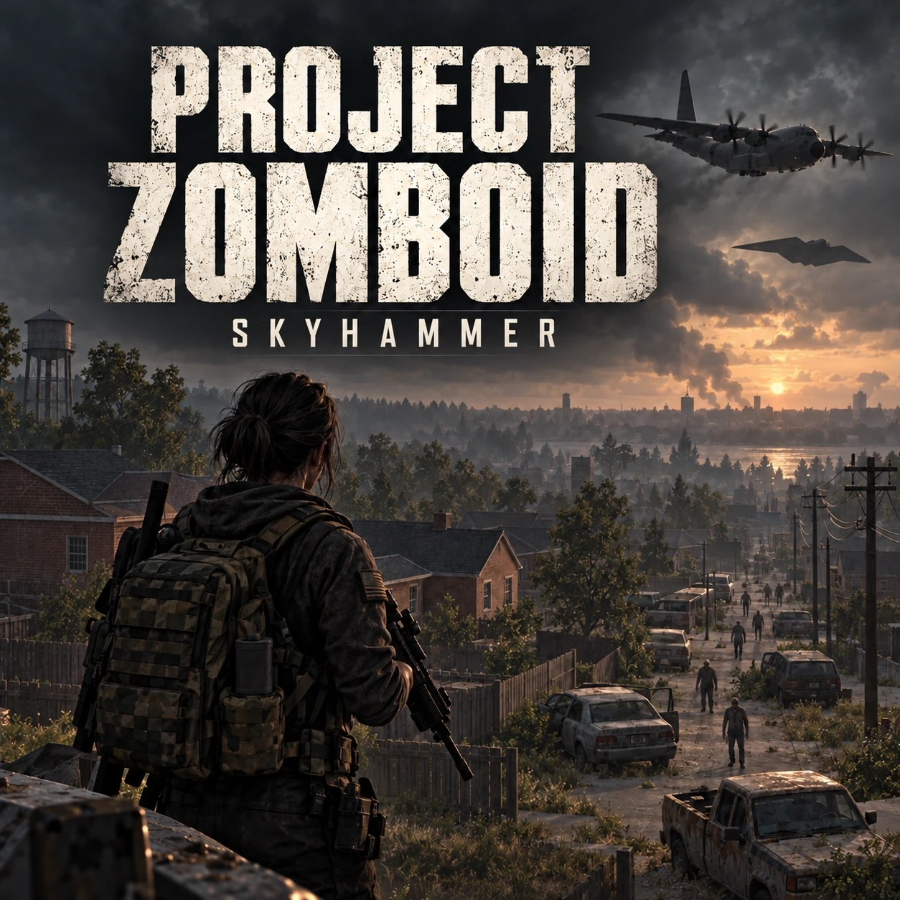

# SKYHAMMER AIR SUPPORT · Project Zomboid Mod

Sources of the Skyhammer mod series for Project Zomboid Build 42.21: call an Apache, an A-10, an AC-130 and a B-2 over the radio.

| folder | mod | Workshop |
|---|---|---|
| `SkyhammerAirSupport` | Skyhammer Air Support (Viewpoint edition): Apache, A-10, AC-130, B-2 and the tactical nuke | [3813483790](https://steamcommunity.com/sharedfiles/filedetails/?id=3813483790) |
| `SkyhammerThor` | THOR add-on (orbital rod) | [3816298691](https://steamcommunity.com/sharedfiles/filedetails/?id=3816298691) |
| `SkyhammerJaeger` | ODIN add-on (giant robot) | [3815899202](https://steamcommunity.com/sharedfiles/filedetails/?id=3815899202) |
| `SkyhammerWraith` | Wraith Team add-on | [3813821529](https://steamcommunity.com/sharedfiles/filedetails/?id=3813821529) |
| `SkyhammerWraithOperator` | Wraith Operator occupation | [3813870006](https://steamcommunity.com/sharedfiles/filedetails/?id=3813870006) |

The [Vanilla (multiplayer) edition](https://steamcommunity.com/sharedfiles/filedetails/?id=3813973682) is built from the main mod by `SkyhammerAirSupport/source/build_vanilla.js`.

Each mod's `42` folder is what ships on the Workshop. `source` holds what builds it: the radio lines and translations (`lines.json`, `ui_*.json`, `build.js`), the Java/3D aircraft code, art, sound sources and the Lua tests (`source/tests`, run with Lua 5.1 through lupa).

## Use

- **Please do not re-upload these mods**, whole or in part, to the Workshop or anywhere else.
- **Compatibility patches and add-ons are welcome**: depend on the Workshop item instead of copying its files. Questions and bug reports: the Discussions tab on the Workshop page.
- Unless a file says otherwise, all rights are reserved. The 3D aircraft geometry and the Java aircraft code are MIT (`SkyhammerAirSupport/common/LICENSE-aircraft.txt`).

## Credits

- Inspired by [Dark Zone Fire Support](https://steamcommunity.com/sharedfiles/filedetails/?id=3791733763) (Raven Bloodqueen) and [Shadowcopter](https://steamcommunity.com/sharedfiles/filedetails/?id=3787424467) (qwerto).
- Sounds: rubberduck's "25 CC0 bang / firework SFX" (CC0), BigSoundBank (CC0), Celestial SFX. Voices: Chatterbox, Piper and Kokoro TTS; the ODIN add-on's pilot is VOICEVOX:青山龍星.
- Artwork: AI-generated.
- Project Zomboid, Viewpoint and ZombieBuddy belong to their authors and are not included here.
